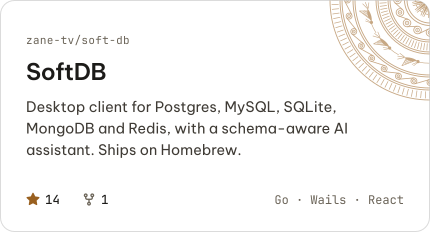
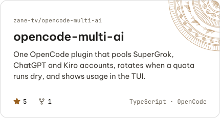
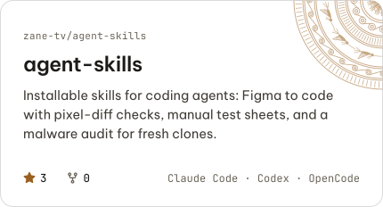
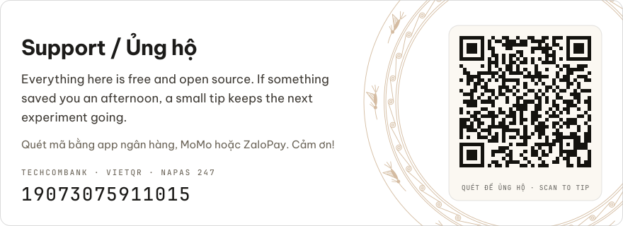

<!-- Generated by `bun run build` from src/content.ts. Edit the source, not this file. -->

<picture><source media="(prefers-color-scheme: dark)" srcset="assets/hero-dark.svg"></picture>

<picture><source media="(prefers-color-scheme: dark)" srcset="assets/roles-dark.svg"></picture>

  <a href="https://github.com/zane-tv/soft-db"><picture><source media="(prefers-color-scheme: dark)" srcset="assets/work-soft-db-dark.svg"></picture></a>
  <a href="https://github.com/zane-tv/opencode-multi-ai"><picture><source media="(prefers-color-scheme: dark)" srcset="assets/work-opencode-multi-ai-dark.svg"></picture></a>
  <a href="https://github.com/zane-tv/tiktok-live-temple-rpc"><picture><source media="(prefers-color-scheme: dark)" srcset="assets/work-tiktok-live-temple-rpc-dark.svg"></picture></a>
  <a href="https://github.com/zane-tv/agent-skills"><picture><source media="(prefers-color-scheme: dark)" srcset="assets/work-agent-skills-dark.svg"></picture></a>

  <a href="https://github.com/zane-tv?tab=repositories&sort=stargazers"><picture><source media="(prefers-color-scheme: dark)" srcset="assets/stats-dark.svg"></picture></a>
  <a href="https://github.com/zane-tv?tab=repositories"><picture><source media="(prefers-color-scheme: dark)" srcset="assets/languages-dark.svg"></picture></a>

<picture><source media="(prefers-color-scheme: dark)" srcset="assets/activity-dark.svg"></picture>

Lately: a local-first OCR and translation extension that runs on WebGPU, agent skills for motion-graphics videos in [holdframe](https://github.com/zane-tv/holdframe), and more interactive TikTok Live stages.

<picture><source media="(prefers-color-scheme: dark)" srcset="assets/support-dark.svg"></picture>

Copy the account number · Sao chép số tài khoản

`19073075911015` · Techcombank

<a href="https://www.linkedin.com/in/zane-tv">LinkedIn</a> · <a href="mailto:tientv.63.work@gmail.com">tientv.63.work@gmail.com</a>
